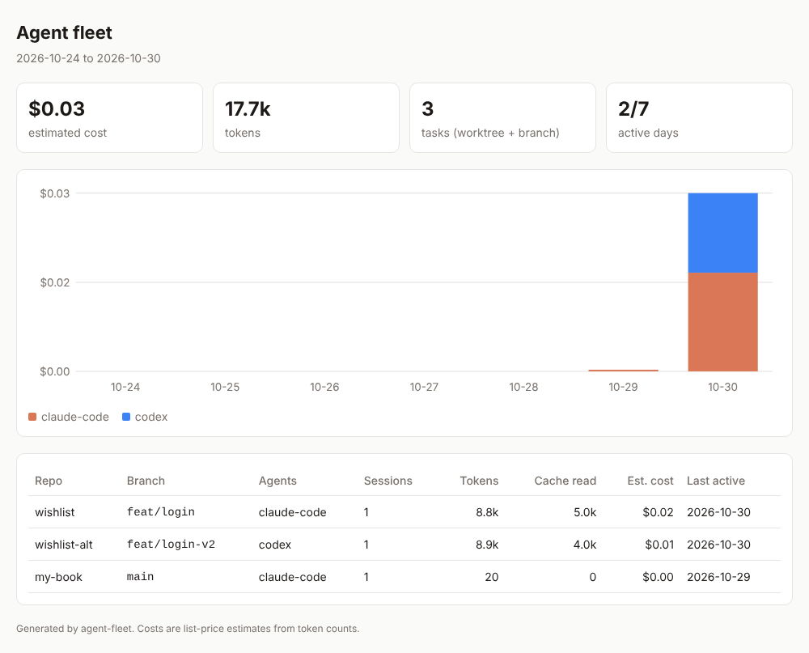

# agent-fleet

**Run coding agents like a team, and see what each one cost and delivered.**

`agent-fleet` is a local-first sidecar for people who run several coding agents in parallel
(for example with [Orca](https://github.com/stablyai/orca), where every agent gets its own git worktree).
It reads the logs your agents already write, maps every model call to the worktree and branch it ran in,
and turns that into per-task token and cost accounting plus a daily report.

- **Per-task accounting.** One task = one worktree + branch. Tokens (input, output, cache read/write) and estimated cost per task.
- **Multi-agent.** Claude Code and Codex today, normalized into one event model.
- **Dashboard.** A self-contained HTML page: cost per day by agent, and every task in the period.
- **Daily report.** Markdown or JSON: totals, per-agent split, per-task table, and the commits each task produced that day.
- **Local and private.** Reads files on your machine; nothing is uploaded.

## Quick start

```bash
git clone https://github.com/cgold9820-dotcom/agent-fleet && cd agent-fleet
npm install && npm run build
node dist/src/cli.js report                       # today, to stdout
node dist/src/cli.js report --date 2026-10-30 --out reports/2026-10-30.md
node dist/src/cli.js report --json                 # machine-readable
node dist/src/cli.js dashboard --days 14           # writes reports/dashboard.html
```



## How it works

```
~/.claude/projects/**/*.jsonl ─┐                 ┌─ git rev-parse (worktree, repo)
~/.codex/sessions/**/rollout-* ┼─► UsageEvent[] ─┼─► TaskSummary[] ─► daily report (md / json)
                               │   (normalized)  └─ pricing table      + git log per worktree
```

| Source | What we read | Notes |
|---|---|---|
| Claude Code | `assistant` records: `message.usage`, `cwd`, `gitBranch` | One response is split across records; deduped on `message.id + requestId` |
| Codex | `session_meta` (cwd, branch), `turn_context` (model), `token_count` | Totals are cumulative; we bill deltas. Cached tokens are split out of input |

Costs are **list-price estimates** (USD per 1M tokens, longest model-id prefix wins, cache read 0.1x and cache write 1.25x for Claude).
Subscription plans bill differently, so treat the number as a comparison metric. Override prices with `--pricing prices.json`:

```json
{ "my-custom-model": { "input": 1, "output": 4, "cacheRead": 0.1, "cacheWrite": 0 } }
```

Log locations respect `CLAUDE_CONFIG_DIR` and `CODEX_HOME`, or pass `--claude-dir` / `--codex-dir`.

## Roadmap

See [docs/ROADMAP.md](docs/ROADMAP.md): Orca workspace names, multi-approach comparison with automated evals, scheduled email digests.

## Development

```bash
npm test   # builds and runs node:test against fixtures in test/fixtures
```

## License

MIT
